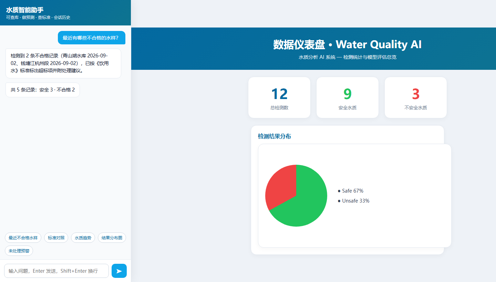

<h1 align="center">水质 AI 检测系统 · Water Quality AI Detection System</h1>

<p align="center">用机器学习判断饮用水能不能喝：Jakarta EE Web 应用 + Python FastAPI 推理服务 + MySQL</p>

<p align="center">
  <a href="https://openjdk.org/"></a>
  <a href="https://tomcat.apache.org/"></a>
  <a href="https://jakarta.ee/"></a>
  <a href="https://www.python.org/"></a>
  <a href="https://scikit-learn.org/"></a>
  <a href="https://fastapi.tiangolo.com/"></a>
  <a href="https://www.mysql.com/"></a>
  
</p>

<p align="center">
  <a href="#快速开始">本地运行</a> ·
  <a href="#ai-模型与指标">模型指标</a> ·
  <a href="#文档导航">文档导航</a> ·
  <a href="#常见问题">排错</a>
</p>

> 🎓 **人工智能引论 + 数据库原理与技术实习** 课程设计。
> 这是一个课程作业仓库：没有 CI、没有单元测试（只有一个需要服务先启动的手工冒烟脚本），
> 所有指标都在同一份公开数据集内部可比，**不构成对真实供水系统的安全判断**。

## 这个系统做什么

用户填入 9 项理化指标，服务端调用 Python 推理服务给出"可饮用 / 不可饮用"、概率、水质等级、
综合水质指数（WQI）与处置建议，并把每一次检测落库，供后续查询、预警、统计与备份。

| 使用者 | 能做什么 |
| --- | --- |
| 未登录访客 | 只有首页与登录 / 注册；其余路径被 `AuthFilter` 跳回登录页 |
| 登录用户 | 提交 9 项指标做检测（结果连同概率、水质等级、WQI 落库）、仪表盘趋势、最近 100 条检测记录与详情、预警列表、水质标准 / 公告 / 反馈 / 模型对比页、个人中心 |
| 管理员 | 以上全部 + 数据库全量备份与快照恢复（`BackupServlet`） |

几处与"完整产品"有差距、但属课设范围内的简化实现，写在这是为了避免误读代码：
注册时的角色只影响称呼，**除备份页外没有第二处角色鉴权**；历史列表不按用户隔离（取全站最近 100 条）；
预警列表是只读的，处理状态只在数据库里维护；批量预测端点 `/predict/batch` 目前只有
`test_api.py` 调用，Web 界面走的是单条预测。

界面共 22 个 JSP 页面、17 个 Java 类，数据库 12 张表；AI 侧提供 8 个 REST 端点。

## 界面预览



截图为课程答辩时的存档快照，实际界面可能已经变化。另有
[系统架构图](docs/assets/system-architecture.png)、[模块划分图](docs/assets/system-modules.png)、
[数据库结构图](docs/assets/db-schema.png)、[ER 图导出](docs/assets/mysql-er-diagram.png) 留在 `docs/assets/`。

## 系统组成

```
浏览器 ──► Jakarta EE Web（Tomcat，JSP + Servlet + JDBC）
              │  登录/注册、检测提交、仪表盘、备份恢复
              ├──► HTTP  POST http://127.0.0.1:8000/predict/single
              │         Python FastAPI 推理服务
              │           ├ 预处理 + Voting 集成 + 概率标定（单个 Pipeline 产物）
              │           └ 安全门规则引擎（领域知识覆盖模型判定）
              └──► JDBC ──► MySQL  water_quality_db
```

三段职责互不重叠：Web 层管权限与展示，AI 层只管预测，数据库管记录。
**`PredictServlet` 里的 AI 地址是写死的 `127.0.0.1:8000`**，改端口要同步改这一处。

## 快速开始

### 环境要求

| 组件 | 版本 | 依据 |
| --- | --- | --- |
| JDK | 编译目标 17；开发机为 JDK 26 + Tomcat 11 | [pom.xml](WaterQualitySystem/pom.xml) |
| Maven | 3.9+ | [pom.xml](WaterQualitySystem/pom.xml) |
| Python | 3.11+ | [requirements.txt](WaterQualityAI/requirements.txt) |
| MySQL | 9.6（InnoDB，`utf8mb4`） | [mysql/water_quality_db.sql](mysql/water_quality_db.sql) |

Servlet 6.0 属于 Jakarta EE 10 命名空间（`jakarta.*` 而非 `javax.*`），**必须用 Tomcat 10 及以上**。

### 1. 初始化数据库

```bash
mysql -uroot -p < mysql/water_quality_db.sql
```

种子数据含 12 张表与示例记录，其中 `users` 表里带三个可登录账号：
`admin / admin123`（管理员）、`testuser / test123`、`inspector1 / inspector123`。
密码在库里以 `SHA2(明文, 256)` 存储——**这是课程设计级别的实现，不是安全的密码方案**（无盐、单向 SHA-256），
部署到任何公网环境前必须换成 bcrypt/scrypt/Argon2。

### 2. 启动 Python 推理服务

```bash
cd WaterQualityAI
python -m venv water_ai_env
water_ai_env\Scripts\activate          # Linux/macOS: source water_ai_env/bin/activate
pip install -r requirements.txt
python ai_api.py                       # http://127.0.0.1:8000/docs
```

服务启动时会加载同目录下的模型产物，缺任何一个直接抛错退出——**不会退回写死的旧指标**。

### 3. 构建并部署 Web 应用

```bash
# 数据库口令走环境变量（DBUtil.java 读取，代码里没有明文）
export DB_PASSWORD='你的MySQLroot密码'      # Windows: set DB_PASSWORD=...

cd WaterQualitySystem
mvn package                                # 产出 target/WaterQualitySystem.war
cp target/WaterQualitySystem.war "$CATALINA_HOME/webapps/"
```

改动只涉及 JSP 时可依赖 Tomcat 热编译；改到 Java 就必须重新 `mvn package` 并重启 Tomcat。

**首次使用请留意：**

- `mysqldump` 与 `mysql` 需要在系统 PATH 上，管理员的备份/恢复功能靠 `ProcessBuilder` 调它们；备份落在 `~/water_quality_backups`。
- 备份/恢复必须带 `--set-gtid-purged=OFF`，否则恢复到本机 MySQL 会报 ERROR 3546；步骤见
  [备份恢复手册](mysql/backup_manual.sql)。
- 只重训模型不会自动改变网页上的模型指标：`dashboard.jsp` 与 `model_info.jsp` 读的是 MySQL 的
  `ai_model_info` 表，需要执行 [建库脚本](mysql/water_quality_db.sql) 里注释掉的 `UPDATE` 语句同步。
- 模型产物 `best_model.pkl`（约 10.5 MB）由 scikit-learn 1.8.0 生成，跨大版本加载可能报错或行为漂移，
  因此依赖全部钉了版本。

## AI 模型与指标

生产模型是 **SVM + 随机森林的 soft voting 集成**，在 3,276 条 `water_potability.csv` 上训练，流程：

```
原始数据 → 中位数缺失值填充 → StandardScaler 标准化 → Voting 集成训练
        → 袋外(OOF)概率拟合 sigmoid 标定曲线 → 宏平均 F1 选决策阈值
```

预处理与集成绑在同一个 Pipeline 产物里（`best_model.pkl`），推理时只要 `predict_proba`；
概率标定曲线单独存一个约 1 KB 的 `probability_calibrator.pkl`（原因见下方"概率为什么要标定"），
线上顺序是：Pipeline 出概率 → 标定曲线换算 → 与阈值比较。不存在"线上少做一步预处理"的可能。
类别不均衡（正类 39.0%）用 `class_weight='balanced'` / `scale_pos_weight` 处理，**不用 SMOTE**：
重复交叉验证里 SMOTE 使 AUC 掉 0.004~0.006，还会把决策阈值推到 0.6 以上。

### 指标口径

主口径是 **5 折 × 3 次重复交叉验证（全量 3,276 条）**，且每一折只在自己的训练分片内部完成标定与定阈值。
之所以不用单次留出：656 行的测试集上 AUC 标准误约 ±0.02，比模型之间的差距还大，
用它判断"谁更准"等于抛硬币。固定 20% 留出的结果仍然保留在 `model_evaluation.csv` 里作对照。

| 模型 | 准确率 | F1 | AUC | 备注 |
| --- | --- | --- | --- | --- |
| 集成学习Voting（生产） | **0.6641** ±0.0049 | **0.5573** | **0.7025** ±0.0048 | SVM+RF + 概率标定，阈值 0.44 |
| SVM 单模 | 0.6607 | 0.5540 | 0.6956 | 集成里的一员 |
| 随机森林单模 | 0.6584 | 0.5390 | 0.6868 | 集成里的一员 |
| LightGBM | 0.6427 | 0.5123 | 0.6691 | |
| XGBoost | 0.6348 | 0.5111 | 0.6639 | |
| 梯度提升树 | 0.6257 | 0.4899 | 0.6478 | |
| 决策树 | 0.6195 | 0.4128 | 0.5962 | |
| 旧线上模型（RF200+SMOTE+KNN，阈值 0.5） | 0.6274 | 0.5381 | 0.6723 | 优化前实际部署 |
| 旧文档模型（RF+SVM+LightGBM+SMOTE，阈值 0.5） | 0.6568 | 0.5531 | 0.6930 | 优化前 README 声称 |
| 多数类基线（全部判为不合格） | 0.6099 | — | 0.5 | **参照下限** |

相对旧线上模型的 15 折**配对**差值：准确率 +0.0367（p=0.0035）、F1 +0.0192（p=0.0002）、
宏平均 F1 +0.0303（p=0.0026）、AUC +0.0302（p=0.0019）。
相对旧文档模型则只有 AUC 显著（+0.0095，p=0.047），F1 差异落在噪声里（p=0.65）。

三点必须说清的边界：

1. **准确率在这里是个弱指标。** 正类只占 39%，"全部判不合格"就有 0.610，比本项目之前对外报出的
   0.5899 还高——那个数字是在测试集上搜阈值搜出来的（已修复，见 `model_evaluation.csv` 的评估协议列）。
2. **这份数据的信号本身很弱。** AUC 约 0.70 已接近该数据集公开研究的水平，不要期待"准确率 90%"。
   特征工程（溶解性总量/消毒副产物比值）、缺失指示位、log1p 压长尾都试过，交叉验证里更差，已删除。
3. **安全门与数据集量纲冲突（先前存在，未擅改）。** 门控按 `Solids ≥ 1500 ppm` 判超标，而这份数据的
   Solids 中位数约 2 万，实测对数据集内每一行都会触发，于是接口恒返回 `Unsafe`、模型概率在最终标签上
   看不出来。响应里因此新增了 `ml_prediction` / `safety_gate_triggered` / `safety_gate_reason` 三个字段，
   用来区分"模型判不安全"与"模型判安全但被规则拦下"。

### 概率为什么要标定

集成输出的概率挤在 0.13~0.76（袋外 1%/99% 分位），而 `water_grade` 要 `≥0.8` 才是 Good、`≥0.9` 是 Excellent——
也就是说这两个等级永远不会出现。在袋外概率上拟合一条 sigmoid（Platt）标定曲线后，留出集上的概率
铺到 0.09~0.85（1%/99% 分位），各等级都可达。标定严格单调，所以**排序与 AUC 完全不变**，只改刻度。

### 产物清单与复现

| 文件 | 内容 |
| --- | --- |
| `WaterQualityAI/best_model.pkl` | 预处理 + Voting 集成的完整 Pipeline（`compress=3`，约 10.5 MB） |
| `WaterQualityAI/probability_calibrator.pkl` | 袋外概率上的 sigmoid 标定曲线（约 1 KB） |
| `WaterQualityAI/best_threshold.pkl` | 决策阈值 0.44 |
| `WaterQualityAI/model_evaluation.csv` | 逐模型指标 + 评估协议 + 旧流程对照组 |
| `WaterQualityAI/model_metrics.json` | 指标、配对检验、协议说明（`ai_api.py` 的指标来源） |

```bash
cd WaterQualityAI
python model_train.py        # 约 15 分钟；覆盖写入以上产物、ROC/混淆矩阵图，并同步 WAR 里的两张引用图
```

## 目录结构

```
├── WaterQualitySystem/          Jakarta EE Web 应用（Maven，WAR）
│   ├── src/main/java/           17 个类：Servlet、DAO、Filter、DBUtil
│   ├── src/main/webapp/         22 个 JSP + Crystal 设计系统 + ECharts
│   └── pom.xml                  Java 17 / Servlet 6.0 / mysql-connector-j 8.3.0
│
├── WaterQualityAI/              Python 推理服务与训练
│   ├── ai_api.py                FastAPI 入口（8 个端点、安全门、WQI）
│   ├── model_train.py           训练与评估（重复交叉验证 + 配对比较）
│   ├── data_preprocess.py       预处理链、概率标定、特征分析
│   ├── chat_*.py                可选的聊天智能体（需 `SILICONFLOW_API_KEY`，走环境变量）
│   ├── test_api.py              手工冒烟脚本（需服务已启动）
│   ├── water_potability.csv     训练数据（3,276 条）
│   └── README.txt               本模块的独立说明
│
├── mysql/                       数据库
│   ├── water_quality_db.sql     建库 + 种子数据 + 指标同步 UPDATE
│   ├── backup_manual.sql        备份恢复手册
│   └── tools/                   一次性脚本（SHA-256 迁移、重建用户表、团队信息更新）
│
├── docs/                        聊天智能体说明 + assets/ 截图与架构图
└── CLAUDE.md                    开发约定（分层、JDBC 事务、ECharts 坑、部署流程）
```

## 文档导航

| 想了解什么 | 从这里开始 |
| --- | --- |
| 编码约定、JDBC 事务模式、部署与测试流程 | [CLAUDE.md](CLAUDE.md) |
| Python 模块的独立说明与端点列表 | [WaterQualityAI/README.txt](WaterQualityAI/README.txt) |
| 模型指标、评估协议、配对显著性 | [model_metrics.json](WaterQualityAI/model_metrics.json) · [model_evaluation.csv](WaterQualityAI/model_evaluation.csv) |
| 数据库结构、种子数据、指标同步 | [mysql/water_quality_db.sql](mysql/water_quality_db.sql) |
| 备份与恢复的手动 SQL | [mysql/backup_manual.sql](mysql/backup_manual.sql) |
| 聊天智能体的工具编排与提示词 | [docs/聊天智能体说明.md](docs/聊天智能体说明.md) |

## 常见问题

| 现象 | 原因与处理 |
| --- | --- |
| 启动 `ai_api.py` 报 `FileNotFoundError: best_model.pkl` | 脚本按自身所在目录找产物，必须在 `WaterQualityAI/` 下运行，或先 `python model_train.py` |
| Web 页面显示 500 或预测无结果 | AI 服务没起 / 端口不是 8000；`PredictServlet` 里地址写死 `127.0.0.1:8000` |
| 登录报连接失败或 `Access denied` | 忘了导出 `DB_PASSWORD`（`DBUtil` 从环境变量取密码，代码里没有明文） |
| 数据库恢复报 ERROR 3546 | 缺少 `--set-gtid-purged=OFF` |
| Windows 控制台跑训练脚本中文乱码 | PowerShell 执行 `chcp 65001` 或设 `PYTHONIOENCODING=utf-8` |
| 网页模型对比图与训练结果不符 | 训练脚本会自动同步 `images/` 里的两张引用图；若手动删过图，重跑 `model_train.py` |
| JSP 改动不生效 | 只改 JSP 可靠热编译；改到 Java 必须 `mvn package` + 替换 WAR + 重启 |

## 协作方式

课设仓库，改动走分支即可：`git checkout -b <名字>` → 本地验证 → 提交 PR，
由仓库所有者合并。提交信息沿用 `feat:` / `fix:` / `docs:` / `chore:` 前缀。
验证按影响面对应做：改模型重跑训练并核对 `model_evaluation.csv`；改 API 用 `test_api.py` 冒烟；
改 Java 必须 `mvn package` 过一遍；纯文档只查链接与数字是否与产物一致。

## 课程信息与许可

- 课程：人工智能引论 · 数据库原理与技术实习
- 数据：`water_potability.csv`（公开的饮用水可饮用性数据集）
- 作者：[@Xiaoyuan-114](https://github.com/Xiaoyuan-114) · 2026

本项目**仅作课程设计展示与学习交流用途**，仓库内没有 `LICENSE` 文件，即未授予任何开源许可；
不要把它用于真实供水决策。第三方依赖各自遵守其原始许可证，
`water_potability.csv` 的使用遵守其原始数据来源的授权条件。

如果需要正式的开源许可证，得由仓库所有者决定并单独添加 `LICENSE` 文件——本文档不代为声明。

`.env`、数据库内容与实际检测记录属于运行数据，不随仓库公开。
